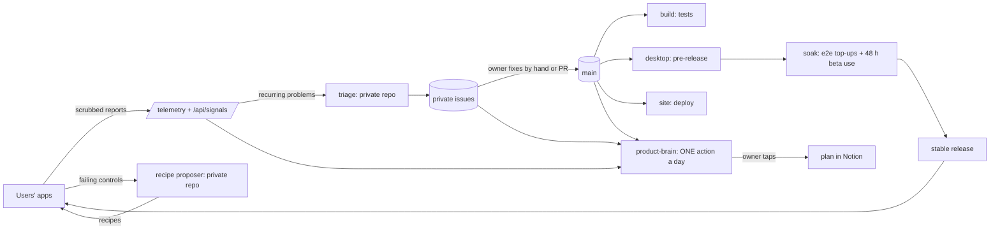

# How Job Pilotto runs itself

> **Read this first in a new session.** What runs on its own, when, what it may change, and where the owner
> approves. Every workflow in `.github/workflows/` must be listed here (`tests/test_how_it_runs.py` fails otherwise).
> The prompts of the product brain and the self-review are private (repo `GarryOne/job-pilotto-internal`, synced into secrets).

## 🧭 Strategy
Private: the owner's **📍 Product Compass** and **💰 IP & Monetization** in Notion (🧭 Strategy). Hard rules that shape
the code: never auto-apply or press Submit; LinkedIn, Glassdoor, Indeed, levels.fyi and Reddit only through the user's own visit or a plain answer, never past a login or a check; ask before spending
money on AI; every manual fix becomes an app step (CLAUDE.md → Working rules).

## 🔁 How the loops connect

## ⚙️ Every automatic loop

| Loop | Trigger | Does | May change | Output | ✋ Owner gate |
|---|---|---|---|---|---|
| `build.yml` · CI · Tests | every push to main | calls the four suites below (python, worker, site, desktop on Linux + Windows): main's backstop, read by red-main and the release gates | nothing | red main | fix it (AGENTS.md "Red main") |
| `tests-python.yml` · `tests-worker.yml` · `tests-site.yml` · `tests-desktop.yml` · CI · Tests · <area> | a pull request whose files match the workflow's `on: paths:` (owner, 14 Oct 2026: no shared pick) | that area's suite | nothing | not required (a paths-skipped workflow never reports); red shows on the PR | fix, push again |
| `desktop.yml` · Release · Build, test, beta | nightly 04:00 Zurich (the Worker's cron; GitHub's schedule as fallback), only when the app changed ("Nightly beta"); by hand: `tools/beta-release.sh` ("Beta by hand") or a plain dispatch ("Build only", not tested) | **one run per release, two parallel lanes** (7 Oct 2026): Anything new? (creates the release: version, tag, draft) → **Mac lane:** Build · Mac (steps: Unit tests, Compile, Smoke test in beta mode only, publish) → **E2E · Mac + Linux** (one box: the gate suites, planned once by Anything new?) → **Release · Mac beta** (HTML report, then `Beta-approved:`) ‖ **Windows lane:** Build · Windows (the same steps; its slow installed-app checks, add-on, update in place and in-app terminal, are the weekly smoke's) → **E2E · Windows** (the same suites, fixed path) → **Release · Windows beta** (`Beta-approved (Windows):`) → Clean up old builds (keeps each platform's newest beta). The first build done publishes the pre-release; a lane never waits for the other (the same suite on both takes turns on its Notion page); a scheduled e2e skips while a release run tests; rebuilds main if workflows changed mid-build | releases | GitHub pre-release | promote (or canary) |
| `windows-smoke.yml` · CI · Windows smoke | weekly (Mondays 06:17 UTC) | builds the Windows app from main and installs it on a fresh runner, with no release: runner or bundled-native drift shows up in a quiet week | main | screenshots (artifact) | — |
| `python-windows.yml` · CI · Python tests on Windows (by hand) | by hand only | the desktop app's Python unit tests (`tools/check.sh --area python --app-only`) on a Windows runner, about two minutes, no build and no e2e: for making the Windows Build run them like the Mac does | main | the log | — |
| `mac-smoke.yml` · CI · Mac smoke (by hand) | by hand only (`tag` = the release whose Mac .zip to test; empty = the newest) | the Mac smoke test (`desktop/scripts/mac-smoke.mjs`: signature, bundled Python, Keychain, the packaged binary, the Jobs screen) on an already published build, about a minute, no e2e; for fixing the smoke test itself | main | screenshot (artifact) | — |
| `record-sites.yml` · CI · Record sites (by hand) | by hand only (owner, 12 Oct 2026; `only` = row words, several joined by `\|`; `share` = how many, at most 3) | the applying pool's PUBLIC rows held on a Linux runner (`desktop/e2e/record-sites.mjs`): fake applicant, never Submit, the app's AI on the Tests key through the metering proxy, hard caps 3 rows and $0.50 a run, one run at a time through a queue that never drops one, CI's own site ledger (2 visits a host a day across all CI runs; read from each run's state artifact; not in the Mac's), a bot wall = "blocked (CI IP)", never retried, red below the row's last CI run | — | job summary table + artifact (day report, evidence per row) | each dispatch spends the Tests key: on the owner's or coordinator's ask |
| `site-replays.yml` · CI · Site replays · all (offline) | a pull request touching desktop/, extension/ or worker/; by hand | the pool's newest network records (14 days, decrypted on the runner with `NET_RECORD_KEY`) replayed with the PR's build (`desktop/e2e/replay-records.mjs`): no site visit, no model call | "N of M rows same as live" in the job summary and /admin/lab-form-filling "Replay vs live"; informational, never required; no key: it says so and stops | – | – |
| `fix-verdicts.yml` · CI · Fix verdicts (offline replays) | after the nightly offline replay on main (when something it replays changed); by hand | per landed fix: its row's recording from before the fix replayed on main twice after a control; per row that got less far: the newest recording on the older build that got further (`desktop/e2e/verify-plan.mjs`, `verify-row.mjs`, `lib/verify-judge.mjs`): no site visit, no model call | "Confirmed offline" / "Not better offline" / "Needs a recording" and "Our build" / "Site changed" on /admin/lab-form-filling's Fixed tab; never required | – | – |
| `site-replays-pr.yml` · CI · Site replays · PR (10 rows) | a pull request that changes the apply flow's code or the replay machinery its steps start (`on: paths:` from `tools/replay-files.mjs`; not required) | at most 10 pool rows (`desktop/e2e/replay-pick.mjs`: 100% same as live in the last green scheduled replay, quickest, one per site first) replayed offline with the PR's build on up to 5 macOS runners at once, judged against that run (`replay-gate.mjs`); no site visit, no AI | a PR that changed either: red when a counted row got worse or a runner did not finish (required as "replay gate"; any other PR passes in seconds) | the run's summary | — |
| `site-replays-accept.yml` · CI · Site replays · accept | the label `replay-accepted` added or removed on a PR, or a trusted `Replay-accept:` comment on it | re-runs only the failed verdict of that PR's replay gate (it reads the label and comments live; same replays, $0), then "all checks green"; main's copy, never the PR's code | the owner's accept on the PR | the gate turns green without an admin override | — |
| `replay-refill.yml` · CI · Replay refill (by hand) | by hand only (`pr` = the PR number); never a PR-started run, never a fork | refills the pinned rows' missing AI answers a prompt change made stale (one row per runner, the network record replayed, no site visit, fake applicant), publishes them through the record guard, re-runs the PR's replay gate; its own key `REPLAY_REFILL_ANTHROPIC_KEY`, no fallback; cap 40 asks / $3 | new answers in the private `net-records` release (never an old answer) | the owner merges the PR; the spend is on /admin/ai-cost (`replay-refill`) |
| `edge-check.yml` · CI · Edge check | by hand only | on a Windows runner: does the app's launcher find Edge, and does Edge load the unpacked extension (spike for an Edge variant of the apply suite) | — | log only | — |
| `e2e-windows.yml` · CI · End-to-end on Windows | the release run's **E2E · Windows** job (the Windows beta gate); started by a scheduled Mac run (`e2e.yml`, job "Windows follows") when it tested something; or by hand with `suites` | runs the same suites as that Mac run on the same commit and seed, with the AI screenshot review when the Mac run had it (`desktop/e2e/plan-windows.mjs`); a commit Windows already tested is not run again; one Windows run at a time. Skips stable canaries, RC soaks and promotion dry runs. Never gates a release The apply suite runs a second time in Microsoft Edge (`E2E_BROWSER=msedge`). | red run + screenshots (artifact `e2e-artifacts-windows-<suite>`); findings filed by `ui-findings.yml`, labelled `platform:windows` | the Actions page | secrets `E2E_*` as e2e.yml |
| `e2e.yml` · CI · End-to-end on Mac + Linux | the release run's **E2E · Mac + Linux** job (every gate suite on the build's commit; all green and `build.yml` green → `Beta-approved:`), **three times a day on main** (09:47, 13:47, 17:47 UTC; on a new commit; on an unchanged one it takes a second and a third look at another seeded path (only the suites that vary) and stops: 3 runs per commit at most), by hand, and on pushes to desktop/e2e or the extension (only the suites whose files changed) | four suites in parallel (wizard, jobs, interviews, settings), each from its own state in its own Notion test page, driving the real app on a Mac: the first-run path, Actions and Recent activity with a slow AI, Interviews, every Settings section | main | screenshots per suite (artifacts) | — |
| `page-cases.yml` · CI · Page cases | every push to main, a pull request touching extension/, desktop/lib/ or desktop/e2e/ (`on: paths:`; not required), or by hand | replays ALL recorded cases (`desktop/e2e/recorded`) with the real extension on Linux, four shards, 4 tabs each; no AI, no network | nothing | red/green: a red run on main blocks pushes like a red build | a failing case: fix forward or revert |
| `control-tests.yml` · CI · Control tests (measure, not required) | a pull request or a push to main touching `extension/` or the zoo, or by hand | replays the widget zoo (`desktop/e2e/widget-zoo`: one hand-made page per control shape) with the real extension on Linux; prints per page read / committed (step summary + artifact) | nothing | never red for a miss; red only when the replay broke or a page pressed a submit | a broken replay: fix the harness; a miss is a fill-ladder bug (spec 2026-10-12-fill-ladder) |
| `pr-gate.yml` · CI · Pull request | every pull request (tools/ship.sh opens it) | the pure gates (same script as the push hook, `CI_GATES=1`), `flow-fresh` (main changed a flow file this PR also changes: ship rebases), "cases fail before the fix" (once "hole 3") of the recorded-case gate, "all checks green" (waits for every other workflow of the commit, green only when each ended green: `tools/all-checks-green.sh`) | nothing | the only required checks (they start on every PR; the owner merges) | a failing check: fix, commit, `tools/ship.sh` again (it reuses the PR) |
| `harness.yml` · CI · Harness tests | a pull request that changes the harness's code (`on: paths:`: desktop/e2e/ but not recorded cases, fixtures or the zoo; stage.mjs; desktop's packages) | the e2e harness's own unit tests, 2 shards | nothing | not required (a paths-skipped workflow never reports); red is visible on the PR | fix the test or the harness, push again |
| `ui-findings.yml` · CI · UI findings (producer) | after every e2e run (four a day), or by hand | files what the layout checks, the AI screenshot review and failed suite steps found as GitHub issues (labels for severity, kind, view, suite; the screenshot, the app's state, logs; "Seen again" and "Not seen" comments, the build tested on each; closes an issue after a second clean run, or the first when a commit says `Fixes #N` (never one a person labelled `confirmed`: only a fix closes it); probe issues close when the probe presses the same control again and it is fine) | issues, the evidence tags `ui-evidence-<run>` (root commits; desktop/e2e/lib/evidence.mjs) | issues labelled `auto-ui` | a person marks real ones `confirmed`, false ones `wontfix-auto` |
| `ui-ranking.yml` · CI · Top issues list | when a loop issue is opened, closed, reopened or relabelled, or by hand | rebuilds the pinned "Top issues" list and the `priority:P0..P3` labels (order: priority, clean-last-run last, score × kind × critical path, Mac before Windows) | the pinned issue, `priority:` labels | the pinned list | nobody |
| `self-heal-stats.yml` · CI · Self-heal stats | every 3 hours, or by hand | the loop's numbers from GitHub (issues by detector and outcome, precision, fixer PRs, verdicts, AI cost per real bug, recall, real bugs) published to the owner's page /self-heal (PUT /self-heal/data, `SELFHEAL_PUBLISH_KEY`) | D1 `selfheal_snapshots`, one row per day | https://www.jobpilotto.top/self-heal (owner-only) | nobody |
| `ai-cost-billed.yml` · CI · AI cost billed | every 6 hours, or by hand | what Anthropic billed per day (Admin API cost report) published to the owner's page /ai-cost, next to what each scheduled job reports (`desktop/e2e/ai-cost-report.mjs`); needs ANTHROPIC_ADMIN_KEY, else it only prints a line |
| `finder-review.yml` · UI loop · Finder self-review | Saturday 17:00 UTC, or by hand | the Finder's week (`desktop/e2e/finder-review.mjs`: per-detector outcomes, false-positive verdict reasons, harness issues, duplicates, detector misses, fixes handed to a person) → Claude proposes at most 3 rule/prompt changes in `desktop/e2e`, each with a test; e2e unit tests must pass | one PR `finder-review/<date>` | the PR | the owner merges |
| `ui-verdict.yml` · CI · UI verdicts | after every UI-loop filing, or by hand (only with `JOB_PILOTTO_FIXER_VERDICTS=on`) | up to 5 one-off findings judged in parallel by Claude, read-only (code + screenshot): real -> `confirmed`, false positive -> closed `wontfix-auto`, else `needs-human` | issue labels and comments | the issues | nobody |
| `judge-exam.yml` · CI · Judge exam | Sunday 08:17 UTC, or by hand (only with `JOB_PILOTTO_JUDGE_EXAM=on`) | the verdict pass's exam (`desktop/e2e/lib/judge-exam.mjs`): eleven findings from the loop's own history with known answers (five real, six false) and the code as it was at their build, judged like real findings and scored; about ten judgements, so off by default | nothing (it only measures) | the score on /self-heal | — |
| `tracker-sync.yml` · CI · Bug Tracker rows | when an issue without the `auto-ui` label closes | a bug a person reported on GitHub that the Finder had not found becomes a row in the Notion Bug Tracker (`desktop/e2e/lib/tracker-write.mjs`) with the replay command; needs `NOTION_BRAIN_WRITE_TOKEN` and `BUG_TRACKER_DB`, otherwise it does nothing | one row in the Bug Tracker | the row | — |
| `issue-fixed.yml` · CI · Fixed-issue labels | when an issue with the `auto-ui` label closes | a Finder issue that a commit or merged pull request closed ("Fixes #N") with no verdict gets `confirmed` and `resolution:fixed`, so the stats count it as a real bug, fixed (`desktop/e2e/lib/fixed-close.mjs`); a fix that changed only tests or docs gets `needs-human` instead (a test mistake, or a product fix made in another commit); a closure that already has a resolution label is left as it is | the issue's labels and one comment | — | |
| `code-review.yml` · CI · AI code review | every 8 hours, or by hand (a range) | Claude reads every product commit since the last review that ran (read-only; at most 30 a run, the rest carried to the next) for bugs that would hurt a person; files each with file:line, a scenario and the failing test (`auto-ui`, `source:code-review`), at most 5 | issues | issues labelled `source:code-review` | the verdict pass or a person confirms; nobody merges anything from it |
| `mutation.yml` · CI · Mutation test | Sunday 01:00 UTC, or by hand | each suite once unmutated, then each mutant of `desktop/e2e/mutants.json` (a real bug written into critical-path code) through `e2e.yml -f mutant=<id>`, one at a time; caught = red suite or a new finding; no AI review, nothing filed from those runs, never counted by the release gate | the mutation score (run summary, `mutation-result` artifact) | one `detector-miss` issue per missed mutant | a person adds the check that would catch it |
| `schedule-watchdog.yml` · CI · Schedule watchdog | hourly at :23 UTC, or by hand | checks that the Worker's cron started the scheduled runs on time (`worker/scripts/watchdog.mjs`, `worker/src/watchdog.js`); a missing start keeps one "⏰ On-time starts missing" issue open (label `schedule-watchdog`), all seen again closes it | issues only | the check in the run summary | none |
| `stable-canary.yml` · CI · Stable canary | daily 06:23 UTC, or by hand | runs the e2e journey on the **stable** tag (no paid AI judge) unless the gate passed on it in the last 20 h; red → one `stable-canary` issue (fix forward or roll back), green → closes it. Never files into the UI loop's backlog |
| `ui-fix.yml` · CI · UI fixer | daily 05:30 UTC, or by hand | picks the most critical ready issue (severity × sightings this week, `confirmed` doubles); Claude Code fixes it test-first in `desktop/renderer`, or, for a confirmed logic bug, in `src/` or `desktop/lib/`; every suite and the lint must pass; guard + desktop tests; ONE pull request (at most 3 open) | a branch `auto-fix/<id>` | the pull request, with the screenshot as "Before" | owner merges the PR; with `JOB_PILOTTO_FIXER_AUTOMERGE=on` a window-only fix of at most 80 lines that passed every suite merges itself (engine fixes never) | Auto-merge (repo variables): `JOB_PILOTTO_FIXER_AUTOMERGE=on` a window-only fix ≤80 lines; `JOB_PILOTTO_FIXER_AUTOMERGE_ENGINE=on` a confirmed `src/`/`desktop/lib/` fix ≤40 lines with its own test. After a merge it closes the issue and runs that issue's suite again. A verdict `harness` (the test was wrong) closes the issue with label `harness`; the Finder self-review fixes the test.
| `sentry-fix.yml` · CI · Sentry fixer | daily 06:30 UTC, or by hand | reads unresolved issues of Sentry `job-pilotto/job-pilotto-app`; keeps real (an `e2e` report only if tagged `expected:no`), fresh (≤ 7 days), error-level, not one-off, no PR in the last 14 days; Claude Code fixes the most critical with a test first; guard + desktop and Python tests; ONE pull request (at most 3 open) | a branch `sentry-fix/<short id>` | the pull request | owner merges the PR; nothing merges itself |
| `canary-promote.yml` · Release · Promote to stable | 01:17, 09:17, 17:17 UTC; by hand (dry run; `force_tag` + `force_reason` = the hot path, skips the soak) | with `JOB_PILOTTO_SOAK` on: end-to-end top-up runs on the candidate (about every 7 h), then `tools/canary_promote.py` decides: ≥ 48 h out, `build.yml` green, e2e green ≥ 3× over ≥ 24 h with no red among the last 3 and no open high-severity finding on its commit, no new telemetry problem, and healthy opt-in beta use (≥ 3 installs, ≥ 30 runs, no crash; thin evidence is only noted until `JOB_PILOTTO_REQUIRE_BETA` is on). Unproven after 5 days → a `release-decision` issue. Every run also relabels the releases (`tools/sync_release_labels.py`: ✅ STABLE · 🧪 BETA (release candidate) · 🔨 Build · 📦 Previous stable) and updates the pinned "Release channels" issue | the Latest release only when `JOB_PILOTTO_AUTO_PROMOTE` is `on` | the decision in the run summary | variables `JOB_PILOTTO_SOAK`, `JOB_PILOTTO_AUTO_PROMOTE`, `JOB_PILOTTO_REQUIRE_BETA`, secret `JOB_PILOTTO_TELEMETRY_KEY` |
| `promote-dry-run.yml` · CI · Promotion dry run | by hand (`-f tag=desktop-v<version>`) | what promoting that release to stable would do (`tools/release-stable.sh`), changing nothing | | | |
| `beta-approve.yml` · CI · Release to beta | called by a gate by hand (`e2e.yml -f gate_tag`, `e2e-windows.yml -f tag`) | the release step of that gate: no real high-severity finding, the shared release checks, then that platform's `Beta-approved` line (the release run does the same in its own Release · Mac/Windows beta jobs) | | | |
| `site.yml` · Release · Website | push touching `site/` | deploys the website worker | the live site | jobpilotto.top | — |
| `worker.yml` · Release · Worker | push touching `worker/src/`, its `wrangler.toml`, `package*.json` or `scripts/` (not this workflow file); by hand | the Worker's tests, then `npm run deploy` (wrangler deploy + the secrets check) of `sre-job-pilotto-bot`: the Telegram bot and the on-time schedules; independent of the desktop release run and of the site | the live Worker | Cloudflare | — |
| `site-next.yml` · Release · Website preview (next) | push touching `site-next/` | deploys the preview worker | the website preview (no data of its own) | next.jobpilotto.workers.dev | — |
| Triage · private repo `GarryOne/job-pilotto-internal` (`triage.yml`, daily 05:47 UTC) | pulls recurring problems from the site's queue (several installs, or very often) → one issue per problem in the private repo | issues (private) | `telemetry` / `fill-failure` issues there | act on the issue |
| `product-brain.yml` · Product brain | daily 05:00 UTC; Sunday 16:00 strategy review | reads the owner's 📍 Product Compass, numbers, the website (screenshots), GitHub → ONE action serving the phase; Sunday: proposes Compass changes (Opus, web) | Notion Decisions (+ Compass on ✅) | Brain bot card | ✅ Explore, ✅ Approve, ✅ Update the compass |
| `daily.yml` · Find new jobs | user's private repo (every 4 h) | crawl, score, digest, kits | the user's Notion | Telegram digest | user submits |
| `scout.yml` · Find new employers | user's private repo, **optional** (off for new installs) | probes public job-feed APIs | the user's employer list | Telegram | — |
| `central-scout.yml` · Central scout | private repo `GarryOne/job-pilotto-internal` (daily; with Common Crawl board discovery, learned priorities and a weekly Swiss canary, all private) | runs the public engine's scout with no user data, verifies every feed, uploads the index to the website (`PUT /api/index`, secret `INDEX_PUBLISH_KEY`) | the shared employer index (KV) | apps and Always-on runs download it (worldwide feeds with the places they hire in; each install crawls only feeds with roles in *its own* `search.json` places, `JOB_PILOTTO_INDEX_ALL=1` for all): `GET /api/index`, at most daily, cached, merged with the starter `config/sources.json`; API down → cache/starter, a run never fails | — |
| `mail.yml` · Gmail and Calendar | user's private repo (3× a day) | read-only mail → application events | the user's Notion | Telegram | — |

**Employer index (Stage 1, step E):** the index is product data on our service (Cloudflare KV, `site/src/employers.js`), not
in anyone's Notion; nothing of the user goes up (a plain GET). Clients: `src/employer_index.py`. The owner's Notion
Employers & Sources keeps working on top of it.

**In the app (every user):** Notion schema repair at start (`desktop/lib/schema.js`), data migrations (`migrate.js`),
weekly backup (`backup.js`), update check at start + every 6 h (`updater.js`), technical reports (`telemetry.js`,
off in Settings; never from `npm start`).

**For sessions (local):** `tools/pre-push-check.sh` blocks a push unless all suites + actionlint pass;
`tools/stop-test-check.sh` runs the touched suites before "done".

## 🗂️ Where things live
- **Code map:** `node desktop/scripts/codemap.mjs <words>` · **change loop:** CONTRIBUTING.md · **releases:** RELEASE.md · **rules:** CLAUDE.md
- **Notion (product):** Project Hub → Decision Log (owner decisions, read on demand), 🐞 Bug Tracker, 🧭 Product Brain · Decisions (the Run Log and Session Handoff were retired on 11 Oct 2026: history is in commit messages)
- **Numbers:** the owner's admin pages under `/admin` (overview, website, app, insights, self-healing, AI cost, form filling, feedback; one menu, the stats key; the old `/stats`, `/telemetry`, `/intel`, `/self-heal`, `/ai-cost`, `/feedback` addresses redirect the owner there), and `/api/signals` (JSON; the same key)
